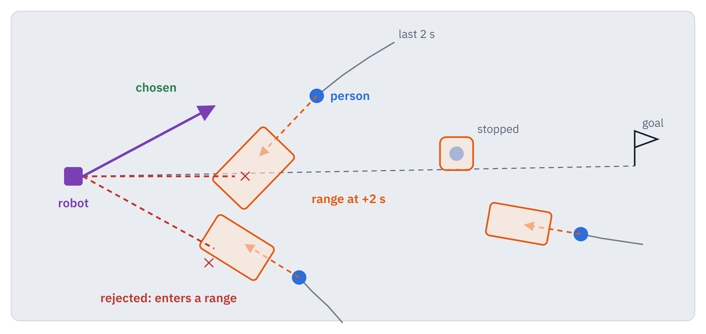
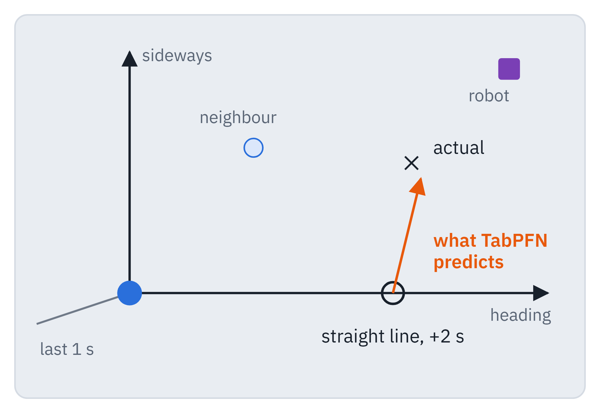
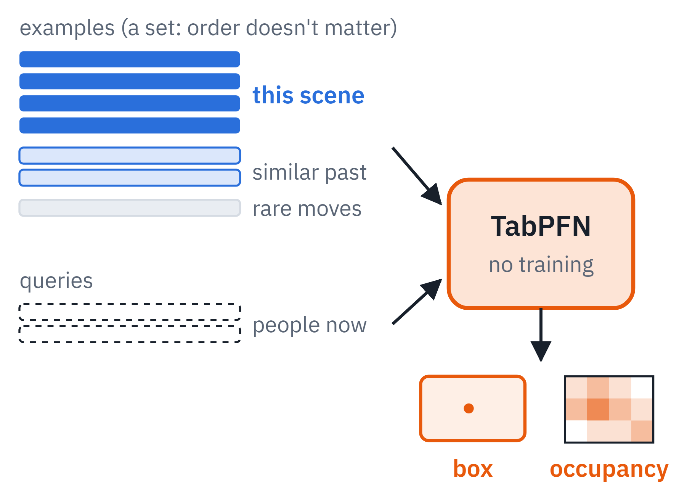
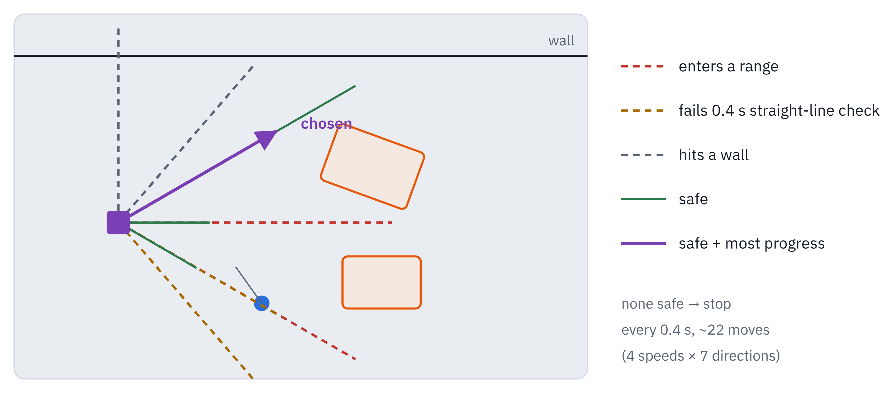
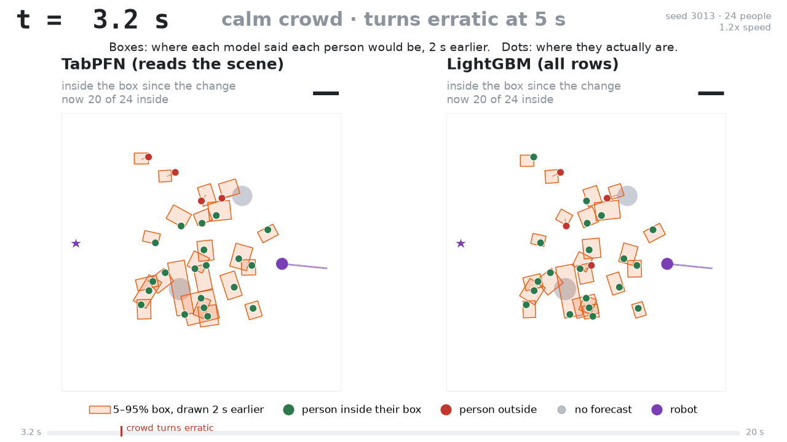
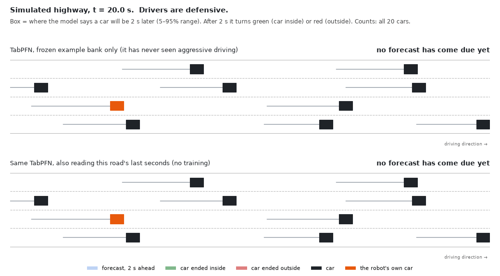
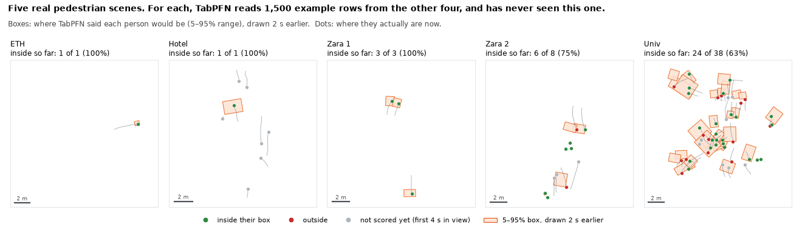

# Foresight

**A robot that knows where everyone around it will be in two seconds, and how sure it can be. It adapts to a new place by reading examples, not by retraining.**

HackLab Berlin 2026 · Prior Labs track · Nooshin Pourkamali and Darshak Panseriya · **[Watch the demo video (2:46)](https://youtu.be/ESSJaxRBox4)**

## ▶ Demo video (2:46)

<p align="center"><a href="https://youtu.be/ESSJaxRBox4"></a></p>
<p align="center"><strong><a href="https://youtu.be/ESSJaxRBox4">Watch on YouTube</a></strong> · a simulated street the model never saw, the three proofs, and where it stops</p>

## The problem

A delivery robot shares the street with people, cars and bikes. To move safely it has to guess where each of them will be next.

Most robots today assume everyone keeps walking straight, or keep one fixed safety margin. Too narrow, and the robot walks into people. Too wide, and it freezes. Learned models guess better, but once trained they are frozen: a new place, or people suddenly moving differently, means training again.

<p align="center"></p>

## How it works

**1. Every moment becomes one row of a table.** How a person is moving, who is near them, where the robot and the walls are.

<p align="center"></p>

**2. TabPFN reads example rows and answers in one step, with no training.** The examples are a fixed bank plus the last few seconds of this very street. When people change how they move, the new rows show it within seconds. [TabPFN](https://github.com/PriorLabs/TabPFN) is a model from Prior Labs that learns from the examples it is shown.

<p align="center"></p>

**3. The robot takes the move that makes the most progress and stays out of every range.** It replans every 0.4 seconds; TabPFN answers in 71 ms on an NVIDIA L4 GPU.

<p align="center"></p>

> **The robot's knowledge is the table. To adapt, swap the rows.**

## Does it work? Three tests

We compared TabPFN with LightGBM, a strong and widely used learned model, under rules we wrote down before each run.

### 1. Adapts to dynamic environments

<p align="center"></p>

A crowd suddenly turns erratic. After the change, TabPFN keeps **59%** of people inside their predicted range, against **41%** for LightGBM: **+18 points, no retraining**. It led in all three crowds we tested. *(The clip is one crowd; its counters differ slightly from the overall numbers.)*

### 2. Works across modalities

<p align="center"></p>

Same core, cars instead of people. With **1,500 examples**, TabPFN predicts as well as LightGBM trained on about **100,000**: the same result with **67× less data**. *(The clip is one road.)*

### 3. Works with very little data

<p align="center"></p>

Five real pedestrian scenes (ETH, Hotel, Zara 1 and 2, Univ), each tested as a place the model has never seen. TabPFN beats the "walk straight plus a fixed margin" guess in **all five** and beats LightGBM given the same examples (in 4 of 5 scenes, level on Hotel). LightGBM needs about **15× more examples** to match it. *(The clip shows one short window per scene.)*

## Where it stops

**Better forecasts did not make our robot faster.** Our planner is simple on purpose: it only asks yes or no, is this move inside a range? At the same safety it reaches the goal 3 to 4 seconds after standard planners. **Next:** a planner that weighs how likely each spot is, instead of a yes/no box.

The robot loop and the cars are simulated; the five pedestrian scenes are real data.

## What it is for

A forecasting layer that sits under whatever planner a robot already runs. A new site, a new crowd behaviour or a new kind of vehicle needs a new bank of examples, not a new training run.

- **Few examples, or behaviour that just changed:** use TabPFN.
- **Plenty of familiar data:** a well-tuned LightGBM does as well.

## Run it

Python 3.11 or 3.12.

```bash
pip install -r requirements.txt
python -m pytest -q
```

<details>
<summary>Rebuild the data and the main results</summary>

On Windows, run these lines in Git Bash. Hosted TabPFN runs need a token from ux.priorlabs.ai in `TABPFN_TOKEN` (never commit it).

```bash
pip install tabpfn-client                 # only for --api runs
# Real pedestrians (ETH, Hotel) from OpenTraj; raw data is not redistributed here
for s in eth hotel; do
  curl -fsSL --create-dirs https://raw.githubusercontent.com/crowdbotp/OpenTraj/master/datasets/ETH/seq_$s/obsmat.txt -o data/raw/$s/obsmat.txt
  python -m foresight.domains.eth_ucy --raw data/raw/$s --out data/$s
done
# Simulated crossing crowd (the example bank)
python -m foresight.domains.crowd --episodes 80 --seed 0 --switch-prob 0.5 --goal-mode cross --out data/crowd_cross
# Tune the tracking filter on training data only
python tools/tune_kalman.py data/hotel --noise 0 --apply-to data/eth
python tools/tune_kalman.py data/eth --noise 0 --apply-to data/hotel
python tools/tune_kalman.py data/crowd_cross --noise 0.1 --split

python tools/claim_a.py                   # ranges in a new place (local TabPFN)
python tools/context_size.py --part local # how many examples are needed
python -B tools/live_variants_cp.py       # reading the scene after a change
python tools/walkthrough.py --seed 6001   # docs/walkthrough.html: one decision, step by step
```

The five real scenes and the cars have their own setup: [`docs/LOSO5.md`](docs/LOSO5.md) and [`docs/HIGHWAY.md`](docs/HIGHWAY.md). The closed robot loop is launched by `tools/t5.ps1` and analysed with `tools/curve_compare.py`; exact settings are in [`RESULTS.md`](RESULTS.md). On an Apple-silicon Mac, follow [`docs/MAC_SETUP.md`](docs/MAC_SETUP.md).
</details>

## Learn more

| Page | What it gives you |
|---|---|
| [`docs/STORY.md`](docs/STORY.md) | Every claim with its number, its source and the words we use for it |
| [`docs/explainer.html`](docs/explainer.html) | A picture-first explainer, about 5 minutes (download and open in a browser) |
| [`docs/walkthrough.html`](docs/walkthrough.html) | One real planning decision, step by step, with the actual values |
| [`RESULTS.md`](RESULTS.md) | The rules written before each run, and every number with its limits |
| [`docs/DEFENSE.md`](docs/DEFENSE.md) | The hard questions, and our answers |
| [`docs/REFERENCES.md`](docs/REFERENCES.md) | Papers and datasets |
| [Demo video](https://youtu.be/ESSJaxRBox4) | The 2:46 video: the 3D street, the three proofs and where it stops |
| Branch `nooshin/dev` | The 3D street behind the video |

## Fine print

- Every pass rule was written before its run, failures stay in the record, and every number comes from a script in this repository.
- Code and docs: MIT licence ([`LICENSE`](LICENSE)). TabPFN itself is not covered: the TabPFN-3.5 weights are for non-commercial use; a product needs the commercial licence or the Apache-licensed TabPFN v2 weights.
- Prepared before the event: generic utilities only (a Kalman filter, a constant-velocity baseline and timing code). Everything else was written at the event.

Thanks to Prior Labs and the HackLab Berlin organisers.
