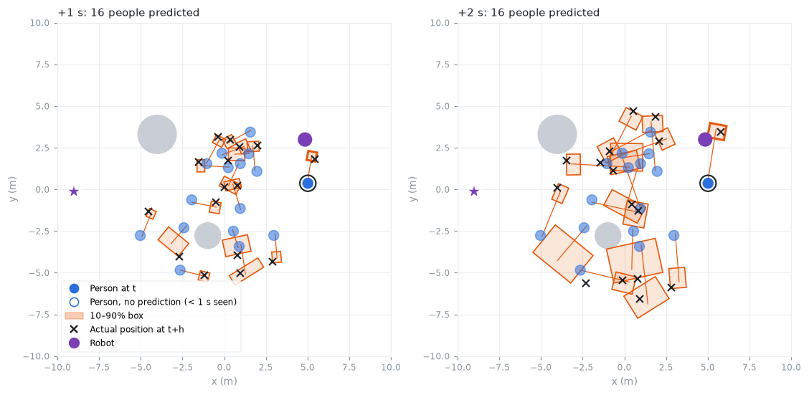
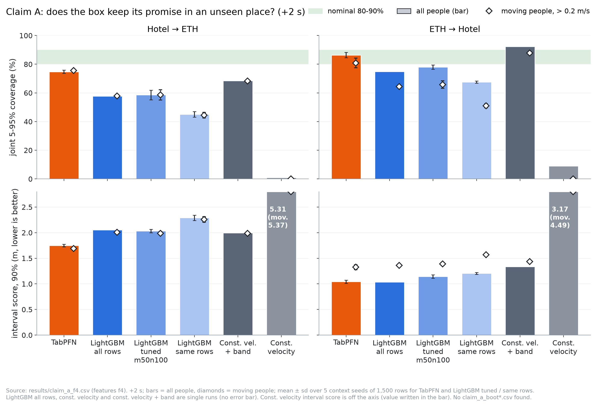

# Foresight

*Where will everyone be in two seconds, and how sure are we?* TabPFN reads a table of what people just did, and the robot keeps clear of the ranges it returns.

HackLab Berlin 2026, Prior Labs track. Foresight is a sense-predict-plan layer for a robot moving among people. Each person at each moment becomes one row of a table. [TabPFN](https://github.com/PriorLabs/TabPFN) reads a few hundred to a few thousand labelled rows as context and returns, in one forward pass and with no training, a 2D range for where each person will be 1 and 2 s ahead. The planner then takes the move with the most progress that stays out of every predicted box. We test one main claim: in a scene it has never seen, TabPFN's ranges stay closer to their promised coverage than LightGBM's, untuned or with a small-data setting. We do not claim lower point error, and we make no safety guarantee.



Video: [link: confirm] · Repository: `shiinalight/Robodetect`

## Start here

| Read | What it gives you |
|---|---|
| [`docs/explainer.html`](docs/explainer.html) | Picture-first explainer, about 5 minutes. Published as an artifact page: [link: confirm]. Also opens locally in a browser (GitHub shows HTML as source) |
| [`docs/walkthrough.html`](docs/walkthrough.html) | One real planning decision, stage by stage, with the actual values (features f4, seed 6001). It shows the earlier mixed-context live planner (80 recent, 588 similar, 226 fill rows); the T5 loop uses the split setup described below |
| [`PLAN.md`](PLAN.md) | The claims and their current status, the framework, the document map |
| [`RESULTS.md`](RESULTS.md) | The pre-registration and its amendments, and every number with its limits. Its real-data tables are still the f1 numbers (banner: being rerun on f4); the f4 numbers are below and in the result files |
| [`docs/DEFENSE.md`](docs/DEFENSE.md) | How the work can be attacked, our answers, and the claims we must not make |

## The problem

A robot crossing a station has to plan around where people will be in the next two seconds. The plan is only as good as the uncertainty it is given. An overconfident range tells the robot a path is clear when it is not, and this is hardest to trust in a place the robot has never seen. A common approach assumes people keep walking straight, or adds one fixed margin. Learned forecasters do better, but they learn one place. Constant velocity is a strong baseline on real pedestrians (Schöller et al. 2020); the hard part is knowing how wrong it might be.

## How it works

1. **Track (S1).** A forward-only Kalman filter, tuned per dataset on training data only, smooths each person's observed positions (`foresight/core/features.py`).
2. **Table (S2).** One row = one person, one moment, one look-ahead (1 or 2 s). Features are in the person's own frame: their recent motion, their 3 nearest neighbours, the robot, the nearest obstacle, local density. The label is the deviation from the walking-straight point. A live query and an offline row give identical features (`tests/test_parity.py`).
3. **Example selection (S3), the rows TabPFN reads.** A frozen bank of 2,000 rows sampled at natural move frequency, cached once, plus a "split" scene model that reads at most 250 of this episode's most recent completed rows, refit every 2 s and used only once their outcome is known (`foresight/core/context.py`, `run_closed.py`, D-30, D-31).
4. **Ranges per person (S4), where TabPFN runs.** TabPFN returns quantiles on each axis for every person and horizon in one batched call. In the split setup the bank and scene models' quantiles are averaged per axis; the bank model runs alone below 20 recent rows (`foresight/core/models.py`).
5. **Calibration (S5).** An online offset widens or narrows the box from completed rows (adaptive conformal, Gibbs and Candès 2021). In the T5 loop it is on, updated once per 2 s batch; a per-row update made the box oscillate and froze the robot (T4 addendum part 4). In T5 the split model's boxes stayed better calibrated than the frozen model's after the behaviour change (result 3b) (`foresight/core/conformal.py`).
6. **Occupancy map (S6).** The same quantiles become a grid of where people may be, used for drawing and for an occupancy metric (metric pending) (`foresight/core/occupancy.py`).
7. **Planner (S7).** Candidate moves that come within a margin of any predicted box at +1 or +2 s, or fail a 0.4 s constant-velocity check, are rejected. Of the rest, the one with the most progress wins. The box quantile (`box_q`, 0.10 to 0.20) is the caution dial (`foresight/core/planner.py`).

TabPFN's weights never change on the robot: adapting to a scene means swapping context rows, not training.

## Results (final on features f4 only)

Every number below names its source. `results/` is git-ignored, so each result file is regenerated by the script named next to it (see "How to run"). Numbers not yet final on f4 are shown as **pending**.

**1. Claim A: ranges in a scene never seen** (real pedestrians, ETH and Hotel, Zurich; context from one scene, test on the other; +2 s; n = 335 rows ETH → Hotel, 324 Hotel → ETH). Source: `results/claim_a_f4.md` / `.csv`, written by `tools/claim_a.py` (TabPFN-3.5 default settings, run locally: D-29, no API entry in `results/api_usage.csv`). Context-dependent models are averaged over 5 context samples of 1,500 rows; "±" is the spread over those samples, **not a confidence interval**. Box = 5–95% on each axis; honest joint coverage is 80–90% (81% if the axes are independent). Interval score (Gneiting and Raftery 2007, 90% interval, mean over axes, m): lower is better.

| Direction | Model | Rows read | Box coverage | Box miss rate | Interval score | 10–90% width | Error |
|---|---|---|---|---|---|---|---|
| ETH → Hotel | Constant velocity | — | 9% | 91% | 3.17 | 0 | 0.254 m |
| | Constant velocity + fixed band | all | 92% | 8% | 1.34 | 0.82 m | 0.254 m |
| | LightGBM, untuned | 1,500 | 68% ± 1 | 32% | 1.20 | 0.41 m | 0.267 m |
| | LightGBM, small-data setting (m50 n100) | 1,500 | 78% ± 2 | 22% | 1.14 | 0.54 m | 0.258 m |
| | LightGBM, untuned | all | 75% | 25% | 1.04 | 0.43 m | 0.253 m |
| | **TabPFN** | 1,500 | **86% ± 2** | **14%** | 1.04 | 0.59 m | 0.244 m |
| Hotel → ETH | Constant velocity | — | 1% | 99% | 5.31 | 0 | 0.428 m |
| | Constant velocity + fixed band | all | 69% | 31% | 1.99 | 0.55 m | 0.428 m |
| | LightGBM, untuned | 1,500 | 45% ± 2 | 55% | 2.29 | 0.41 m | 0.409 m |
| | LightGBM, small-data setting (m50 n100) | 1,500 | 59% ± 3 | 41% | 2.03 | 0.52 m | 0.409 m |
| | LightGBM, untuned | all | 58% | 42% | 2.05 | 0.46 m | 0.405 m |
| | **TabPFN** | 1,500 | **75% ± 1** | **25%** | **1.75** | 0.65 m | 0.403 m |



How to read it. The claim is direction-dependent:
- **ETH → Hotel:** TabPFN's box is inside the honest range; the best LightGBM is just below it (78%). LightGBM on all rows ties TabPFN on interval score (1.04 against 1.04).
- **Hotel → ETH:** every model under-covers. TabPFN is closest (75%) and has the best interval score (1.75 against 1.99 and above), but it does not keep its promise here either.
- **Point error:** every model is within 0.03 m of a well-filtered constant velocity. We claim no point-error gain.
- **Moving people only** (diamonds in the figure): TabPFN covers 81% (ETH → Hotel) and 76% (Hotel → ETH), LightGBM 44–66%, the fixed band 88% and 68%.
- **Intervals that resample whole people** (`tools/claim_a_boot.py` → `results/claim_a_boot_f4.csv`, 5,000 resamples by person, TabPFN minus LightGBM on all rows): Hotel → ETH interval score (5–95) −0.30 [−0.42, −0.18], box miss −17.0 points [−21.0, −13.0]; ETH → Hotel interval score +0.01 [−0.06, +0.07] (level), box miss −11.5 points [−15.7, −7.5] (`RESULTS.md`). The test rows are the f1 evaluation sample, re-scored on f4; on a fresh clone without the f1 row cache, `claim_a.py` draws a new sample.

**2. Data efficiency** (simulated crossing crowd, in-distribution, +2 s, 2,000 test rows, 3 context samples). Source: `results/context_size.csv`, written by `tools/context_size.py`.

| Model | Rows read | Error | Pinball | Box coverage |
|---|---|---|---|---|
| Constant velocity | — | 0.745 m | — | — |
| LightGBM, untuned / small-data setting | 2,000 | 0.706 / 0.705 m | 0.121 / 0.116 | 66% / 73% |
| TabPFN-3.5-Fast, 1 estimator (local) | 2,000 | 0.646 m | 0.106 | 85% |
| LightGBM, untuned | 20,000 | 0.634 m | 0.106 | 79% |
| LightGBM, untuned (one fit) | all 73,163 | 0.606 m | 0.101 | 83% |
| TabPFN-3.5, default (hosted API) | 20,000 | 0.593 m | 0.096 | 87% |

TabPFN on 2,000 rows is about level with LightGBM on 20,000. Choosing rows by similarity instead of at random changed error by at most 0.005 m at 1,000 or 5,000 rows (same file). One simulated scene only.

**3. Claim B: reading the scene's own recent rows, offline in simulation** (T3: crossing crowd with erratic behaviour held out of the bank; 6 episodes switch calm → erratic at 20 s; 636 query rows). Source: `results/live_variants_cp.csv`, written by `tools/live_variants_cp.py`; `RESULTS.md`, amendment 2. Split (bank + recent scene rows) minus frozen bank, both with the online offset, after the switch, 95% person-bootstrap intervals:

| Metric | Split minus frozen |
|---|---|
| Interval score (90% box) | −1.29 [−1.70, −0.94] |
| Box coverage | +12.6 points [+9.0, +16.3] |
| Median error | −0.057 m [−0.092, −0.021] |

Limits: no variant reaches the 80–90% target after the switch (best 68%). The split setup was chosen on this same data (D-30), so this is a selection-stage result; the in-loop check (3b) reproduces it on fresh seeds. Split costs about 3 s per moment offline against 0.27 s for frozen (emulated CPU). On real data (Hotel → ETH, 137 query rows over 44 moments, 83 people) no variant was distinguishable from constant velocity (split vs CV −0.015 m, paired person bootstrap 95% interval [−0.041, +0.010]). Real-data check of claim B (`tools/realdata_claimb.py`, `results/realdata_claimb.csv`), from 5 s, split vs frozen: interval score −0.045 [−0.080, −0.009] pooled over both directions, coverage level, level with the offset; small and direction-dependent.

**3b. Claim B in the closed loop** (T5 exploratory b: crossing crowd, every seed switches into erratic at 5 s, 20 paired seeds 3000–3019, box q 0.15, +2 s against true positions). Source: `results/inloop_claimb.csv`, written by `tools/inloop_claimb.py`; `RESULTS.md`, "Closed loop T5 results". Split minus other, 95% paired-seed intervals:

| After the switch | Split | Frozen TabPFN | LightGBM, all rows | Split minus frozen | Split minus LightGBM |
|---|---|---|---|---|---|
| 5–95 box coverage | 59.3% | 49.3% | 41.3% | +10.0 pts [+8.4, +11.6] | +18.0 pts [+16.7, +19.3] |
| Interval score | 5.03 | 6.34 | 7.03 | −1.31 [−1.55, −1.08] | −2.00 [−2.20, −1.80] |
| Median error | 1.016 m | 1.073 m | 1.036 m | −0.057 m [−0.094, −0.021] | −0.020 m [−0.051, +0.010] |

Limits: no model reaches the 80% target after the switch. Before the switch split is slightly worse (interval score +0.18 [+0.10, +0.27] against frozen). So claim B holds offline and in the closed loop, in simulation only.

**4. Claim C: not supported in the closed loop (run as a stress test, as pre-registered).** In the crowd cell picked from baseline runs alone, by a rule written before any learned planner ran there (some baseline cells were seen before the rule; disclosed in amendment 1), the open-loop oracle (true future positions under the current command) had to beat every baseline by 2 s at matched safety. It did not: against constant velocity at margin 0.2 m it was 1.59 s faster [0.86, 2.39], and velocity obstacles at weight 0.5 was faster than every oracle point. The scene leaves little room: the straight-line time floor averages 17.74 s over the 20 seeds, and velocity obstacles runs only 1.50 s above it. By the pre-registered rule, a failed gate means the closed loop is reported as a stress test, not as evidence for claim C. The oracle plans under the current command while people react to the actual one, so it is not a strict upper bound. Sources: `results/oracle_gate_cross.csv`, `tools/curve_compare.py --a oracle`, D-33, `RESULTS.md` amendment 2.

T5 then ran the primary test on 20 paired seeds (3000–3019). Source: `results/t5_primary.csv`, `tools/curve_compare.py`; `RESULTS.md`, "Closed loop T5 results".
- **The TabPFN planner (tabpfn_split) beats no baseline:** all four fail Holm–Bonferroni (p = 1.0).
- **It is slower at comparable safety:** 4.3 s slower than constant velocity at margin 0.4 at equal minimum gap, 3.0 s at equal collision rate. Constant velocity at margin 0.2 and velocity obstacles at every weight are 3.9–6.2 s faster, so it does not beat them either.
- **Why:** not calibration. At the same caution setting (q 0.15) the split, frozen TabPFN and LightGBM planners all take about 26 s (split − frozen −0.12 s [−1.35, +1.25]; split − LightGBM +0.33 s [−1.29, +1.99], 20 paired seeds), although LightGBM's boxes are 0.63 m narrower after the switch. 40-seed update (exploratory, `results/t5_primary_40.csv`): split and frozen TabPFN still drive the same (+0.03 s [−1.08, +1.16]), but LightGBM's narrower, less honest boxes (41% vs 59% coverage after the switch) make it 1.24 s faster [+0.17, +2.34]; every learned planner stays 3–5 s slower than cv and vo at comparable safety. Better prediction did not change how this box planner drives; its caution setting did. An exploratory dial sweep on fresh seeds tests lower settings (`docs/EXPLORATORY_DIALS.md`).
- **Exploratory (a), safety at matched time** (`results/t5_oracle_matchedtime.csv`): the open-loop oracle beats no baseline on every point and both axes. It buys clearance (minimum gap 0.22 m against 0.09 m for constant velocity at margin 0.2), but collision-rate gains mostly stay below the pre-set margin at 20 seeds.

A 40-seed extension (same arms and rules) was declared after this analysis and before any of its results; the 20-seed analysis above stays the confirmatory result. Showcase seed 3013, picked by the rule in `RESULTS.md`; demo render: `media/demo/seed3013.gif`.

**5. Intent chain: TabPFN at two chained layers, offline.** A TabPFN classifier predicts each person's next manoeuvre (straight, stop, turn left, turn right). Per-manoeuvre TabPFN range models then give the 2 s range, mixed by the classifier's probabilities. The pass/fail gate was fixed in the script before any result. Source: `results/intent_layer.log` / `.csv`, written by `tools/intent_layer.py`; `media/fig_intent_layer.png`.

| Setting | Balanced accuracy (chance 0.25) | Turning people: interval score, chain minus single | Overall interval score | Verdict |
|---|---|---|---|---|
| Real, Hotel → ETH | 0.49 | 3.59 → 3.33, −0.263 [−0.481, −0.075] (73 rows, 37 people) | level, −0.022 [−0.057, +0.009] | adopted |
| Simulated crossing crowd | 0.30 | — | worse | not adopted |

On real data the chain adds 5.0 points of joint coverage overall and 16.9 on turns; median error is 0.007 m worse. Simulated people pick turns at random, so intent is barely predictable there. TabPFN's class probabilities are better calibrated than LightGBM's (log loss 0.24 against 0.71 real, 0.81 against 1.53 simulated). **What the gain is, and is not:** neither classifier ever calls a turn outright on real data (turn recall 0; only 58-63 turn rows in each 2,000-row Hotel context, so turn_right gets no model of its own). The 0.49 balanced accuracy comes from straight (0.99) and stop (0.97). The gain on turning people comes from the classifier's small, well-calibrated probability on turn modes widening those people's ranges (joint coverage 45.7% to 62.6%), not from a sharper turn forecast. In simulation the chain also helps on turn rows (−0.143 [−0.275, −0.005]) but widens everyone else's ranges too much (overall +0.229 [+0.175, +0.287]). Limits: 37 turning people, 3 context seeds on real data, 2 in simulation, offline only (not in the closed loop).

**6. Pending (placeholders, not results)**

| Result | Status |
|---|---|
| T5 latency arm (predictions 0.4 s stale) | dropped from T5 for compute (`RESULTS.md` addendum part 5); now running on the L4 pod, no result yet |
| T5 fast-replan baselines (0.2 s) | reactive m0.4 finished 20 seeds, not yet reported; the other three were stopped (addendum part 5) |
| Claim B on real data (`tools/realdata_claimb.py`) | **done:** real pedestrians (from 5 s, split vs frozen, paired person bootstrap, `results/realdata_claimb.csv`): small gain, interval score −0.045 [−0.080, −0.009] pooled (1,540 rows, 544 people), coverage level (+1.3 pts [−0.5, +3.1]), level with the offset on both; direction-dependent (ETH→Hotel −0.046 [−0.086, −0.005], narrower boxes at equal coverage; Hotel→ETH −0.045 [−0.093, +0.007], level). Against LightGBM: +17.1 pts coverage, interval score −0.254. The real scenes have no sudden behaviour switch, which is where the simulator's +10 pts came from |
| Calibration on arrival and after 20 s in the scene (`tools/conformal_eval.py`) | pending: f4 rerun (the existing table is f1) |
| Time per plan on a GPU (`tools/latency_gpu.py`) | **measured, NVIDIA L4:** TabPFN 71 ms per replan (split design, 48 query rows), scene rebuild 318 ms every 2 s; real loop 225 ms per plan; see `docs/DEPLOYMENT.md` |

**When to use which, so far:** with many familiar rows, LightGBM is as good or better. With few rows or in a new place, TabPFN's ranges are better calibrated. Both under-cover turns.

## Limits, and what we do not claim

- **No safety guarantee.** Calibrated ranges are for efficiency; a worst-case floor is for safety (RSS; ISO/IEC TR 5469, see `docs/INDUSTRY.md`). What exists is the 0.4 s constant-velocity check; a takeover when the predictor is late is designed, not built. Online conformal gives long-run average coverage, not a per-step bound, and conformal safe-planning guarantees assume people who do not react to the robot (Lindemann et al. 2023, Assumption 1).
- **Claim A is direction-dependent:** honest going to Hotel, under-covering (but closest) going to ETH. Two real scenes only, no robot in the real data.
- **Claim B is simulation-only** (offline and in the closed loop), and no model reaches the 80% target after the switch. On real pedestrians the gain is small and direction-dependent: real pedestrians (from 5 s, split vs frozen, paired person bootstrap, `results/realdata_claimb.csv`): small gain, interval score −0.045 [−0.080, −0.009] pooled (1,540 rows, 544 people), coverage level (+1.3 pts [−0.5, +3.1]), level with the offset on both; direction-dependent (ETH→Hotel −0.046 [−0.086, −0.005], narrower boxes at equal coverage; Hotel→ETH −0.045 [−0.093, +0.007], level). Against LightGBM: +17.1 pts coverage, interval score −0.254. The real scenes have no sudden behaviour switch, which is where the simulator's +10 pts came from.
- **Claim C is not supported.** In T5 the TabPFN planner beat no baseline and was slower at comparable safety. The closed loop is a demonstration and a stress test.
- **The intent chain is offline only,** on 37 turning people, with 3 context seeds on real data and 2 in simulation.
- **Simulated people turn far more than real ones:** calm and hurried people in the crossing crowd turn in 8.5–13% of 2 s windows, against 2–3% on ETH and Hotel (D-24, `docs/DATA.md`).
- **Latency:** our timings come from x64 Python emulated on an ARM laptop CPU, a worst case. The simulator runs in virtual time. "Real-time" is not claimed.
- **Licence:** the TabPFN code is Apache 2.0. The TabPFN-3.5 and 3.5-Fast weights we use are non-commercial; the TabPFN-2 weights are Apache 2.0. This is a research prototype; a product would need Prior Labs' commercial licence or the v2 weights. Sizes: 219 M parameters (3.5), 83.5 M (3.5-Fast) (`docs/DEPLOYMENT.md`).

## How we validated

- **Pre-registration with dated amendments.** The closed-loop analysis rule was written before the run (Sat ~20:30). Amendment 1 (commit `0d5d335`), amendment 2 (`889bc36`) and the T4 addendum (`bec10b7`, `6517981`, `722e1bd`, `3df14bf`) were committed before any learned planner ran on the seeds they govern. What was seen first is disclosed: the move to the crossing crowd after T1, baseline cells visible before the picker was written, and exploratory analyses added after the oracle gate (`RESULTS.md`, DEFENSE attack 3).
- **Gates before big runs.** Each stage has a pass/fail check written first (`docs/GATES.md`, tests T1–T5 in `docs/DECISIONS.md`). Failed gates stopped work: T1 (the default plaza could not separate planners, D-19) and the oracle gate (claim C, D-33).
- **Every value has a decision row** (`docs/DECISIONS.md`): backed, assumed or pending.
- **Paired seeds and person bootstrap.** Every planner runs on the same fresh seeds (40 planned from a power calculation, D-14; the learned arms were cut to 20 before any result, addendum part 5, so T5 is analysed on seeds 3000–3019); intervals are paired-seed bootstrap, Holm–Bonferroni across the four baselines. Offline intervals resample whole people.
- **Baseline checked against the literature.** Our constant velocity at 4.8 s is 1.12 m (ETH) and 0.46 m (Hotel), close to the published 1.15 and 0.51 m (Schöller et al. 2020; D-26). Tuning the filter made constant velocity 24–30% stronger, so we reran everything against it (features f4).
- **Leaks found and fixed.** Features f1 leaked world heading: "no obstacle" padding was rotated into the person's frame, and standing people were oriented on the world x-axis (D-20). Earlier, a "distance to the area's edge" feature used the camera's field of view, computed from future positions. Both are gone; f1 results are superseded.
- **Pilot withdrawn.** An early "first 5 s" adaptation result rested on 10 rows in 4 episodes, and its early bin measured retrieved rows, not this scene's rows (DEFENSE attack 4). It is withdrawn (`PLAN.md`).

## How to run

Python 3.11 or 3.12. Windows and Linux (on Windows, run the lines in Git Bash or use `curl.exe` and `$env:` in PowerShell):

```bash
pip install -r requirements.txt           # add: pip install tabpfn-client  (only for --api runs)
export TABPFN_TOKEN=<token>               # PowerShell: $env:TABPFN_TOKEN = "<token>". Accept the licence at ux.priorlabs.ai; never commit it

# Real pedestrians (ETH, Hotel) from OpenTraj; raw data is not redistributed here
for s in eth hotel; do
  curl -fsSL --create-dirs https://raw.githubusercontent.com/crowdbotp/OpenTraj/master/datasets/ETH/seq_$s/obsmat.txt -o data/raw/$s/obsmat.txt
  python -m foresight.domains.eth_ucy --raw data/raw/$s --out data/$s
done
# Simulated crossing crowd (bank)
python -m foresight.domains.crowd --episodes 80 --seed 0 --switch-prob 0.5 --goal-mode cross --out data/crowd_cross
# Features f4: tune the tracking filter on training data only
python tools/tune_kalman.py data/hotel --noise 0 --apply-to data/eth
python tools/tune_kalman.py data/eth --noise 0 --apply-to data/hotel
python tools/tune_kalman.py data/crowd_cross --noise 0.1 --split

python tools/claim_a.py                   # result 1 (local TabPFN)
python tools/context_size.py --part local # result 2; --part api for hosted TabPFN-3.5
python -B tools/live_variants_cp.py       # result 3 (reads the f4 row caches the two lines above build)
python tools/walkthrough.py --seed 6001   # docs/walkthrough.html and figures
python -m pytest -q
```

The closed-loop runs (T2 sweep, oracle gate, T4, T5) are launched by `tools/t2.ps1`, `tools/oracle_gate.ps1`, `tools/t4_*.ps1` and `tools/t5.ps1`, and analysed with `tools/curve_compare.py`; the exact settings are in `RESULTS.md`, amendment 2.

**Apple-silicon Mac:** follow `docs/MAC_SETUP.md`. `scripts/mac/setup.sh` builds the environment and data and runs the tests, `scripts/mac/smoke.sh` checks the GPU (MPS) and times TabPFN, and `scripts/mac/run.sh` runs longer jobs.

## Repository layout

```
INTERFACE.md          data format every simulator or dataset writes (tracks.csv, obstacles.csv, meta.json)
foresight/core/       schema, features (Kalman, rows), context, models, conformal, occupancy, planner, eval
foresight/domains/    crowd.py (social-force crowd with a robot), eth_ucy.py (ETH/Hotel adapter), toy_crowd.py (tests)
foresight/            trace.py (closed-loop trace), viz.py
run_offline.py        rows and offline splits;  evaluate.py: offline table (its published numbers are f1)
run_adapt.py          context strategies after arriving or after a behaviour change
run_closed.py         closed loop: robot crossing the crowd, every planner, per-seed checkpoint
render_closed.py, demo.py, compare.py   videos and figures
tools/                claim_a, context_size, live_variants(_cp), curve_compare, tune_kalman, walkthrough, gates, launchers
tests/                simulator, train/serve parity, planners, robustness
scripts/mac/          setup, smoke test and runs on Apple silicon
docs/                 explainer, walkthrough, decisions, gates, defence, references, data cards, deployment
media/, deck/         figures, clips and the slide deck
```

## References

Key references; the full list (36 entries, with how far each was checked) is in `docs/REFERENCES.md`.

- Hollmann et al. 2025. Accurate predictions on small data with a tabular foundation model. *Nature* 637.
- Jäger et al. 2026. TabPFN-3.5: Technical Report. arXiv:2609.17895. Vendor report, not peer reviewed; the model we run.
- Thomas et al. 2024. Retrieval & Fine-Tuning for In-Context Tabular Models (LoCalPFN). NeurIPS. Classification only.
- Schöller et al. 2020. What the Constant Velocity Model Can Teach Us About Pedestrian Motion Prediction. *IEEE RA-L* 5(2).
- Pellegrini et al. 2009. You'll Never Walk Alone (ETH dataset). ICCV.
- Amirian et al. 2020. OpenTraj. ACCV.
- Helbing and Molnár 1995. Social force model for pedestrian dynamics. *Phys. Rev. E* 51.
- Gibbs and Candès 2021. Adaptive Conformal Inference Under Distribution Shift. NeurIPS.
- Lindemann et al. 2023. Safe Planning in Dynamic Environments Using Conformal Prediction. *IEEE RA-L* 8(8).
- Gneiting and Raftery 2007. Strictly Proper Scoring Rules, Prediction, and Estimation. *JASA* 102.

## Prepared before the event

Generic utilities only: a Kalman filter, a constant-velocity baseline and timing code (`tools/check_tabpfn.py`). Everything else was written at the event. [confirm: the filter and baseline now live in `foresight/core/features.py` and `foresight/core/models.py`; confirm they descend from the pre-event `traj_kit.py` named in `TEAM-PLAN.md`, which is no longer in the repo.]

The reference note `docs/tabpfn-hackathon-strategies.md` was in the first commit (Sat 21 Nov, 16:36). [confirm: whether it was written before the event started.]

[confirm: one line on how AI coding assistants were used.]

## Team and acknowledgements

- Darshak Panseriya: [role: confirm]
- Nooshin Pourkamali: crowd simulator, 3D viewer, Mac timings [confirm]

Thanks to Prior Labs and the HackLab Berlin organisers. [acknowledgements: confirm]
