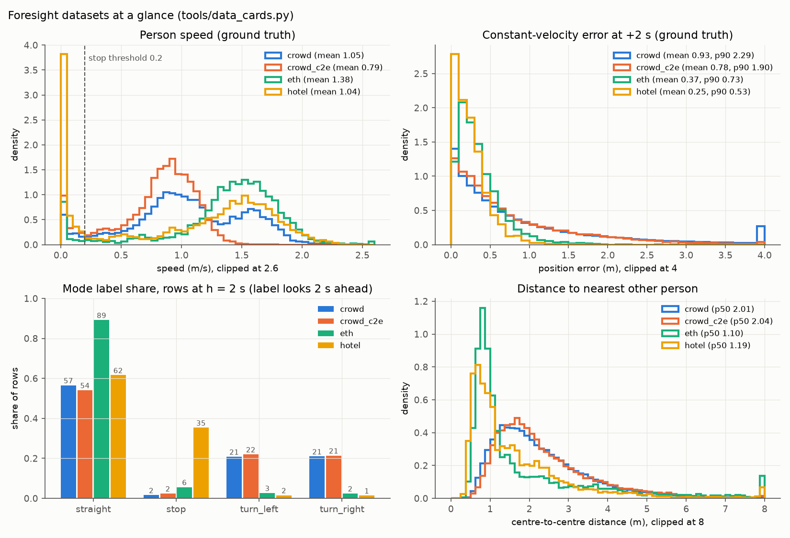
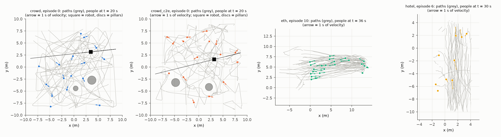

# Data cards

What each dataset in `data/` looks like, so results on it can be read in context. Every number below comes from `tools/data_cards.py`, which reads only the `INTERFACE.md` files and the cached feature rows (`data/<name>/rows_*.parquet`, for the mode labels). Nothing is trained.

Regenerate the numbers and both figures with:

```
python tools/data_cards.py
```

It prints every table below (and a few more integrity numbers) as markdown.





The figures show `crowd`, `crowd_c2e`, `eth` and `hotel`; `toy` is left out because it is a test stand-in.

How to read the numbers:
- **Speed** and **time stopped** (speed < 0.2 m/s) are over person rows. **Walking speed** is over rows at 0.2 m/s or more, so standing people do not pull it down. Simulated agents start from rest at t = 0, so that step is left out for the simulated sets.
- **CV error at +2 s**: distance between the true position 2 s later and the position given by constant velocity from the true state now. It is computed on ground truth with no sensor noise, by matching each row to the same agent 2 s later (10 steps at dt 0.2, 5 at dt 0.4, 20 at dt 0.1). It shows how much of the motion a ruler already explains. Because t = 0 is left out, the simulated numbers are a little lower than `summary()` in `crowd.py` prints.
- **Turns (tracks)**: share of 2 s windows whose heading changes by more than 30 degrees, counted only where the person moves faster than 0.5 m/s at both ends (heading is not defined for people who are standing).
- **Mode labels** come from the cached rows. The label always looks 2 s ahead, whatever the horizon `h`, so shares per horizon differ only in which rows exist. `stop` means the mean speed over the next 2 s is under 0.2 m/s, **or the agent has no data 2 s later** (it left the scene). At h = 2 s every row has a future 2 s ahead, so that second case cannot happen; h = 2 s is the headline.
- **Nearest person**: centre-to-centre distance to the nearest other person in the same frame.

---

## crowd: simulated plaza (training set)

Social-force crowd from `foresight/domains/crowd.py` (`crowd-v1`). 16 people and one robot in a 20 x 20 m plaza with 2 pillars. Each episode starts in one of three regimes (calm, hurried, erratic); 36 of 80 switch once, for the whole crowd, between 14 and 26 s.

| Quantity | Value |
|---|---|
| Episodes | 80 x 40 s (53 min) |
| dt | 0.2 s (INTERFACE.md asked for 0.1 s) |
| People per frame | 16 in every frame (nobody enters or leaves) |
| Person tracks | 1,280 (16 per episode) |
| Speed, mean / p10 / p50 / p90 | 1.05 / 0.40 / 1.04 / 1.67 m/s (max 2.64) |
| Walking speed, mean / p90 | 1.11 / 1.68 m/s |
| Time stopped | 6.0% |
| CV error at +2 s, mean / p90 | 0.93 / 2.29 m (47% of rows under 0.5 m) |
| Turns > 30 deg in 2 s (tracks) | 36.4% of windows |
| Regimes (person rows) | hurried 36%, calm 32%, erratic 32% |
| Episodes by regime | no switch: hurried 17, erratic 14, calm 13. Switch: erratic->calm 7, calm->hurried 7, calm->erratic 6, hurried->erratic 6, hurried->calm 5, erratic->hurried 5 |
| Nearest person, p10 / p50 | 1.04 / 2.01 m |
| Robot | yes, in every episode, mean speed 0.66 m/s |
| Obstacles | 2 circular pillars per episode, radius 0.50-1.18 m |

Mode labels:

| h | rows | straight | stop | turn left | turn right |
|---|---|---|---|---|---|
| 1 s | 122,880 | 56.8% | 1.6% | 20.7% | 20.8% |
| 2 s | 119,040 | 56.6% | 1.6% | 20.9% | 21.0% |

By regime:

| Regime | Mean speed | Walking speed | Stopped | CV error +2 s, mean | Turns (tracks) | Labels at h = 2 s (straight / stop / left / right) |
|---|---|---|---|---|---|---|
| calm | 0.74 m/s | 0.76 m/s | 3.7% | 0.49 m | 25.3% | 65.8 / 1.6 / 15.8 / 16.8% |
| hurried | 1.51 m/s | 1.51 m/s | 0.3% | 1.15 m | 35.5% | 62.9 / 0.0 / 18.6 / 18.5% |
| erratic | 0.86 m/s | 1.00 m/s | 14.5% | 1.11 m | 51.0% | 40.3 / 3.3 / 28.4 / 27.9% |

Observations:
- Constant velocity explains less here than on the real data: mean error at +2 s is 0.93 m, against 0.37 m on ETH and 0.25 m on Hotel. The tail is long (p90 2.29 m).
- Turns are common and stops are rare. 42% of rows carry a turn label, while only 1.6% are `stop`, even though people spend 6.0% of the time below 0.2 m/s. Simulated stops last 0.5-3 s, so few 2 s windows are stopped for their whole length.
- Most turns come from goal picking. People choose a new goal 9.9 times per person-minute (about every 6 s), and 75.5% of the 2 s turns have a goal change inside the window. Windows without one still turn 12.8% of the time (this includes turns that finish a goal change made just before the window), four to six times the real rates.
- Regimes differ the way they were designed: hurried is fastest with almost no stops, erratic stops the most (14.5%) and turns the most (51%), and calm is the easiest for constant velocity (0.49 m).
- Integrity: no duplicate rows, no gaps, no person inside a pillar or outside the plaza, no speed above 2.64 m/s, largest step 0.53 m. Displacement per step matches the stored velocity (median mismatch 0.02 m/s). Agents do touch: 0.45% of person rows have `collided = 1`, 0.44% of nearest-person distances are under 2 x radius (0.6 m), and 51 person rows in 13 episodes overlap the robot (closest edge-to-edge gap -0.13 m).

---

## crowd_c2e: simulated, calm -> erratic test set

Same simulator. 12 episodes (seeds 5000+) that all start calm and switch to erratic at exactly 20 s. Used as a held-out test for the regime switch.

| Quantity | Value |
|---|---|
| Episodes | 12 x 40 s (8 min) |
| dt | 0.2 s |
| People per frame | 16 in every frame |
| Person tracks | 192 |
| Speed, mean / p10 / p50 / p90 | 0.79 / 0.23 / 0.86 / 1.15 m/s (max 1.76) |
| Walking speed, mean / p90 | 0.87 / 1.16 m/s |
| Time stopped | 9.5% |
| CV error at +2 s, mean / p90 | 0.78 / 1.90 m (49% under 0.5 m) |
| Turns > 30 deg in 2 s (tracks) | 35.3% |
| Regimes (person rows) | calm 50%, erratic 50% |
| Nearest person, p10 / p50 | 1.13 / 2.04 m |
| Robot | yes, mean speed 0.64 m/s |
| Obstacles | 2 pillars per episode, radius 0.55-1.04 m |

Mode labels:

| h | rows | straight | stop | turn left | turn right |
|---|---|---|---|---|---|
| 1 s | 18,432 | 54.0% | 2.5% | 22.1% | 21.4% |
| 2 s | 17,856 | 54.1% | 2.4% | 22.0% | 21.4% |

| Regime | Mean speed | Walking speed | Stopped | CV error +2 s, mean | Turns (tracks) | Labels at h = 2 s (straight / stop / left / right) |
|---|---|---|---|---|---|---|
| calm (0-20 s) | 0.74 m/s | 0.76 m/s | 3.3% | 0.49 m | 23.9% | 68.0 / 1.3 / 14.9 / 15.8% |
| erratic (20-40 s) | 0.84 m/s | 0.99 m/s | 15.5% | 1.10 m | 50.7% | 39.3 / 3.6 / 29.7 / 27.4% |

Observations:
- The per-regime numbers match the calm and erratic rows of `crowd` closely (CV error 0.49 and 1.10 m against 0.49 and 1.11 m), so this set tests the switch, not a different crowd.
- After the switch the constant-velocity error more than doubles (0.49 -> 1.10 m) and the turn label share almost doubles (31% -> 57%). The change is large and abrupt by construction.
- It contains no hurried people, so its overall speed (0.79 m/s) is lower than `crowd` (1.05 m/s).
- Integrity: no duplicates, gaps, pillar overlaps or out-of-bounds rows. 0.29% of person rows have `collided = 1`; no person overlaps the robot (closest gap 0.03 m).

---

## eth: real pedestrians, ETH scene

ETH Walking Pedestrians (Pellegrini et al. 2009, via OpenTraj), converted by `foresight/domains/eth_ucy.py`. Annotated from an overhead camera. The recording is cut into 60 s windows; each window is an episode.

| Quantity | Value |
|---|---|
| Episodes | 13 windows of 60 s, 12.9 min end to end |
| dt | 0.4 s (annotated at 2.5 fps) |
| Frames with nobody in view | 25.1% (window 5 is empty after 22.8 s, window 2 has people only from 18.8 to 44.4 s) |
| People per frame, mean / max | 4.6 over all frames, 6.2 over frames with someone / 27 |
| Person tracks / unique people | 390 / 360 (30 people cross a window edge and are split) |
| Track length, median | 9.2 s |
| Speed, mean / p10 / p50 / p90 | 1.38 / 0.69 / 1.47 / 1.84 m/s (max 3.88) |
| Walking speed, mean / p90 | 1.46 / 1.85 m/s |
| Time stopped | 5.7% |
| CV error at +2 s, mean / p90 | 0.37 / 0.73 m (76% under 0.5 m) |
| Turns > 30 deg in 2 s (tracks) | 2.9% |
| Scene | `eth` (the `regime` column holds the scene name; no switches) |
| Nearest person, p10 / p50 | 0.67 / 1.10 m |
| Robot | no |
| Obstacles | none parsed (and no `bounds`, on purpose, see `eth_ucy.py`) |

Mode labels:

| h | rows | straight | stop | turn left | turn right |
|---|---|---|---|---|---|
| 1.2 s | 5,948 | 79.9% | 15.5% | 2.4% | 2.2% |
| 2 s | 5,252 | 89.2% | 5.6% | 2.7% | 2.5% |
| 4.8 s | 3,023 | 87.4% | 7.5% | 2.3% | 2.7% |

Observations:
- Constant velocity already does well: 76% of rows are within 0.5 m at +2 s and the p90 is 0.73 m. A model has a small margin to win on this scene.
- Turns are rare (about 5% of labels) and stops are rare (5.6% at h = 2 s). Almost 9 in 10 rows are `straight`.
- The `stop` share at h = 1.2 s (15.5%) is not behaviour: the share of rows actually slow at t is 6.5% at both h = 1.2 s and h = 2 s. The extra stops at h = 1.2 s are people who leave the view within 2 s and get `stop` because they have no data 2 s later.
- People walk close together (median nearest person 1.10 m, against 2.01 m in the simulated plaza); 1.4% of distances are under 0.5 m, most likely people walking in groups.
- Integrity: no duplicates, no gaps inside tracks, and `tracks.csv` has the same 8,908 rows as the raw `obsmat.txt`, so the converter dropped nothing. Stored velocity matches displacement (median mismatch 0.09 m/s). There are 12 annotation stalls: steps where a walking person (stored speed > 1 m/s) moves less than 0.3 m/s, usually followed by a catch-up step; the largest single step is 1.84 m in 0.4 s. 19 rows from 4 people are above 3 m/s (up to 3.9 m/s), steady over several seconds and consistent with the stored velocity. Nothing exceeds the 5 m/s bound.

---

## hotel: real pedestrians, Hotel scene

Same source and conversion as `eth`, cut into 60 s windows the same way.

| Quantity | Value |
|---|---|
| Episodes | 13 windows of 60 s, 12.0 min end to end (the last window has rows only from 0 to 2.4 s) |
| dt | 0.4 s |
| Frames with nobody in view | 35.4% |
| People per frame, mean / max | 3.6 over all frames, 5.6 over frames with someone / 18 |
| Person tracks / unique people | 433 / 390 |
| Track length, median | 5.2 s |
| Speed, mean / p10 / p50 / p90 | 1.04 / 0.00 / 1.28 / 1.80 m/s (max 2.44) |
| Walking speed, mean / p90 | 1.38 / 1.85 m/s |
| Time stopped | 25.1% (16.3% of rows have speed exactly 0) |
| Standing tracks (mean speed < 0.2 m/s) | 79 of 433, holding 25.4% of rows |
| CV error at +2 s, mean / p90 | 0.25 / 0.53 m (89% under 0.5 m) |
| Turns > 30 deg in 2 s (tracks) | 2.1% |
| Scene | `hotel` |
| Nearest person, p10 / p50 | 0.58 / 1.19 m |
| Robot | no |
| Obstacles | none parsed |

Mode labels:

| h | rows | straight | stop | turn left | turn right |
|---|---|---|---|---|---|
| 1.2 s | 3,469 | 52.2% | 45.3% | 1.3% | 1.2% |
| 2 s | 2,870 | 61.6% | 35.4% | 1.6% | 1.4% |
| 4.8 s | 1,301 | 45.3% | 52.9% | 1.0% | 0.8% |

Observations:
- Hotel is the easiest set for constant velocity: mean error 0.25 m, p90 0.53 m. Standing people help: a person annotated with zero speed who keeps standing has zero constant-velocity error.
- The scene is split between walkers and standers. People are below 0.2 m/s a quarter of the time, and 16.3% of rows have exactly zero velocity, so standing people are annotated as frozen points. ETH has 5.7% stopped time and 3.4% of rows in standing tracks.
- The cached rows contain more standing people than the tracks: 31.7% of rows at h = 2 s are slow at t and 35.4% are labelled `stop`, against 25.1% of track rows. Rows need 2 s of history and a known future, which long standing tracks provide and short walking tracks often do not. At h = 4.8 s the `stop` share rises to 52.9%.
- ETH and Hotel walkers move alike (walking speed 1.46 vs 1.38 m/s, p90 1.85 in both, turns 2.9% vs 2.1%). The scenes differ in standing (5.7% vs 25.1% of time), track length (9.2 vs 5.2 s median) and size (14,223 vs 7,640 feature rows). A model trained on ETH sees few standing people; a model trained on Hotel sees many, and the `stop` label covers a third of its rows.
- Integrity: no duplicates, no gaps inside tracks, no annotation stalls, nothing above 2.44 m/s, largest single step 1.02 m, velocity consistent with displacement (median mismatch 0.07 m/s); rows match the raw file (6,544). 4.7% of nearest-person distances are under 0.5 m.

---

## toy: old stand-in crowd (tests only)

An earlier social-force crowd (`toy-crowd-v1`), kept for tests. Not used for results. No cached feature rows, so no mode labels.

| Quantity | Value |
|---|---|
| Episodes | 40 x 40 s (27 min) |
| dt | 0.1 s |
| People per frame | 16 in every frame, plus one robot |
| Person tracks | 640 |
| Speed, mean / p10 / p50 / p90 | 0.94 / 0.27 / 0.94 / 1.57 m/s |
| Walking speed, mean | 1.01 m/s |
| Time stopped | 7.4% |
| CV error at +2 s, mean / p90 | 0.85 / 1.92 m |
| Turns > 30 deg in 2 s (tracks) | 37.7% |
| Regimes (person rows) | erratic 40%, calm 32%, hurried 28%; 20 of 40 episodes switch |
| Nearest person, p10 / p50 / min | 0.88 / 1.84 / 0.024 m |
| Obstacles | 2 pillars per episode |
| Mode labels | n/a |

Observations:
- Its physics is looser than `crowd`: 2,502 person rows lie inside a pillar, 233 person rows in 17 episodes overlap the robot (closest gap -0.62 m), and 2.5% of nearest-person distances are under 0.6 m, with a minimum of 2 cm. Fine for code tests, not for numbers.
- It has no `collided` column.

---

## Simulated vs real

| | crowd | crowd_c2e | eth | hotel |
|---|---|---|---|---|
| Mean speed (m/s) | 1.05 | 0.79 | 1.38 | 1.04 |
| Walking speed, mean / p90 (m/s) | 1.11 / 1.68 | 0.87 / 1.16 | 1.46 / 1.85 | 1.38 / 1.85 |
| Time stopped | 6.0% | 9.5% | 5.7% | 25.1% |
| CV error +2 s, mean (m) | 0.93 | 0.78 | 0.37 | 0.25 |
| CV error +2 s, p90 (m) | 2.29 | 1.90 | 0.73 | 0.53 |
| Turns > 30 deg in 2 s (tracks) | 36.4% | 35.3% | 2.9% | 2.1% |
| Turn labels at h = 2 s | 41.8% | 43.4% | 5.1% | 3.0% |
| Stop labels at h = 2 s | 1.6% | 2.4% | 5.6% | 35.4% |
| Nearest person, median (m) | 2.01 | 2.04 | 1.10 | 1.19 |
| People per frame, mean | 16.0 | 16.0 | 4.6 | 3.6 |

- **Speed:** simulated people walk slower than real ones. Walking speed is 1.11 m/s in `crowd` against 1.46 (ETH) and 1.38 (Hotel). Only the hurried regime (1.51 m/s) is at real walking pace; calm (0.76) and erratic (1.00) are below both real scenes. The overall means of `crowd` and Hotel look equal (1.05 vs 1.04) only because Hotel's standing people pull its mean down.
- **Stopping:** the simulated time stopped (6.0%) is close to ETH (5.7%) and far below Hotel (25.1%). Simulated stops are short pauses; nobody in the simulation stands for long, while Hotel has 79 tracks of people who mostly stand.
- **Turning:** the largest difference. Simulated people turn more than 30 degrees in 36% of 2 s windows; real people in 2-3%. Three quarters of simulated turns come with a new goal, picked about every 6 s; real pedestrians in these scenes mostly keep one heading while in view.
- **Predictability:** constant velocity is 2.5 to 4 times worse on the simulated crowd than on the real scenes (0.93 m against 0.37 and 0.25 m). Gains over constant velocity on `crowd` should not be read as the gains to expect on real pedestrians, where there is much less left to explain.
- **Density and contact:** the simulated crowd is fixed at 16 people per frame and keeps more distance (median nearest person 2.0 m against 1.1-1.2 m). Real scenes have no robot and no obstacles in the files, so robot and obstacle features are constant there.
